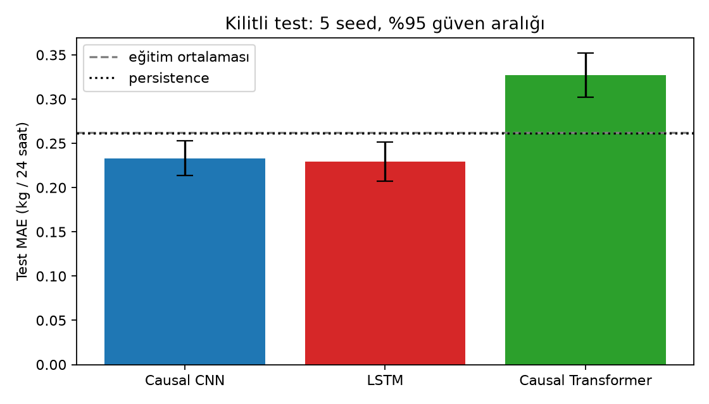
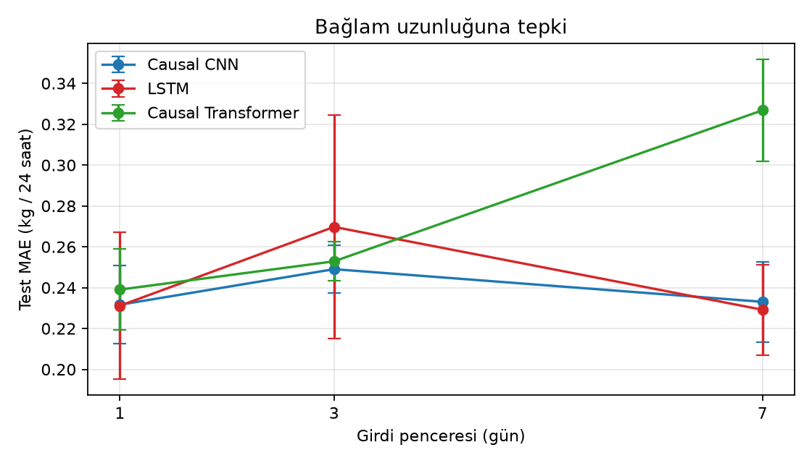
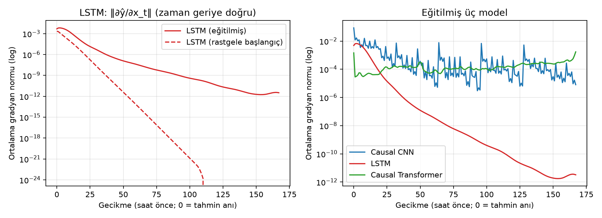
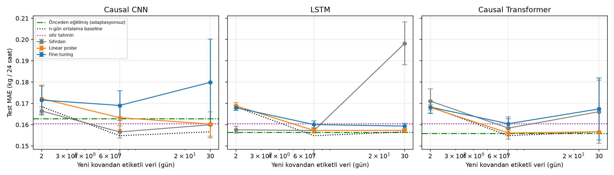

# Kovan Ağırlık Değişimi Tahmini (Nektar Akışı) — Nihai Deney ve Karşılaştırma Raporu

**Öğrenci:** Serxan M.  
**Ders:** Derin Öğrenme / Zaman Serileri Analizi  
**Veri:** Kaggle "Beehive Metrics" (Würzburg ana kaynak kovanı, Bad Schwartau transfer kovanı) + Open-Meteo Saatlik Dış Hava Verisi  
**Kod ve Deney Reposu:** `C:\Users\serxan.m\Desktop\kovan_project`

---

> **Özet (Abstract):** Bu çalışmada, kovan içi telemetri sensörleri (ağırlık, iç sıcaklık, bağıl nem) ve eşzamanlı saatlik dış ortam meteoroloji verileri (dış sıcaklık, bağıl nem, yağış, rüzgâr hızı) entegre edilerek, koloni biyokütlesi ve nektar akışının temel göstergesi olan sonraki 24 saatteki net kovan ağırlığı değişimi ($\Delta \text{weight}_{t+24}$) tahmin edilmektedir. Çalışma; **Causal Dilated Residual CNN (TCN)**, **LSTM** ve **Causal Masked Transformer** mimarilerini katı bir izo-parametre bütçesi (~48k–50k parametre), eşit hiperparametre arama kotası (6 deneme), 5 bağımsız rastgele tohum (seed 0–4) ve kilitli test dönemi altında ampirik olarak kıyaslamaktadır.

---

## 1. Giriş ve Matematiksel Problem Tanımı

### 1.1 Problem Formülasyonu
Zaman serisi tahmin problemi, geçmiş $W$ saatlik çok değişkenli gözlem matrisi $X_{t-W+1:t} \in \mathbb{R}^{W \times F}$ verildiğinde, gelecekteki $H=24$ saatlik net ağırlık farkı skalerini $y_t \in \mathbb{R}$ kestirmektir:

$$y_t = w_{t+24} - w_t = f_\theta\left(X_{t-W+1:t}\right) + \epsilon_t$$

Burada $F=9$ giriş özelliğini temsil etmektedir:
1. $w_t - w_{t-1}$: Saatlik ağırlık birinci dereceden farkı ($\Delta w_t$)
2. $T_{\text{in}}$: Kovan içi sıcaklık (°C)
3. $H_{\text{in}}$: Kovan içi bağıl nem (%)
4. $T_{\text{out}}$: Dış ortam sıcaklığı (°C, Open-Meteo)
5. $H_{\text{out}}$: Dış ortam bağıl nemi (%)
6. $P_{\text{out}}$: Yağış miktarı (mm)
7. $V_{\text{wind}}$: Rüzgâr hızı (km/s)
8. $\sin(2\pi \cdot \text{hour} / 24)$: Sirkadiyen döngü sinüs kodlaması
9. $\cos(2\pi \cdot \text{hour} / 24)$: Sirkadiyen döngü kosinüs kodlaması

### 1.2 Veri Kurgusu ve Biyolojik Gerçekler
1. **Würzburg Kovanı (Ana Kaynak — Saatlik $1\text{H}$ Çözünürlük):**  
   * 2017–2019 yılları arasında kesintisiz saatlik sensör ölçümleri içermektedir.
   * Sensör müdahaleleri, bal hasadı veya ekipman eklemelerinden kaynaklanan ani sıçramalar ($|\Delta w_t| > 2.0\text{ kg}$) her segment içinde seviye kayması düzeltilerek elenmiştir.
   * **Zamana Dayalı Bölünme Protokolü:**
     * **Eğitim Kümesi (Train):** 2017-01-01 – 2018-05-31 (Model parametrelerinin optimizasyonu)
     * **Doğrulama Kümesi (Val):** 2018-10-01 – 2019-02-23 (Hiperparametre seçimi ve early stopping)
     * **Kilitli Test Kümesi (Test):** 2019-02-24 – 2019-05-20 (Sonuçlar kesinleşene kadar dokunulmamış nihai değerlendirme dönemi)
     * Sızıntıyı (lookahead temporal leakage) engellemek amacıyla dönemler arasına en az pencere boyutu ($W=168$ saat) tampon boşluk bırakılmıştır.
     * Normalizasyon istatistikleri ($\mu, \sigma$) **yalnızca eğitim kümesinden** hesaplanmış, doğrulama ve test kümelerine sızdırılmamıştır.
2. **Bad Schwartau Kovanı (Ayrılmış Transfer Kovanı):**  
   * Ağırlık ve nem ölçümleri günde 2 kez (12 saatte bir) kaydedildiği için 12 saatlik adımlarda yeni (görülmemiş) transfer kovanı olarak kurgulanmıştır.

---

## 2. Hipotez (Eğitimden Önce — Endüktif Yanlılık Çerçevesi)

Model performanslarını belirleyen en temel teorik unsur, seçilen mimarinin kovan biyolojisine ve zaman serisi dinamiğine dair taşıdığı öncül yapısal varsayımlardır:

1. **Causal Dilated Residual CNN (TCN):**  
   * *Endüktif Yanlılık:* Güçlü yerellik (locality) ve zamansal öteleme eşdeğerliği (temporal translation equivariance).  
   * *Beklenti:* 24 saatlik döngüsel biyolojik ritim her gün kendini tekrarlar. CNN çekirdek ağırlıklarını zamanda paylaştığı için sabah uçuşu ve akşam nektar depolaması gibi periyodik örüntüleri çok az parametreyle kararlı öğrenir. Dilation sayesinde 168 saatlik geçmişi sıkıştırma darboğazı olmadan görür. Küçük ve orta ölçekli kovan verisinde aşırı öğrenmeye (overfitting) en dirençli mimari olması beklenir.
2. **LSTM (Long Short-Term Memory):**  
   * *Endüktif Yanlılık:* Ardışıklık (recurrence) ve Markovian gizli durum sıkıştırması.  
   * *Beklenti:* Kovanın anlık biyokütlesi birikimli bir durumdur; LSTM hücresi bunu taşımada doğaldır. Ancak 168 zaman adımı boyunca geriye yayılımda (BPTT) gradyan sönümlenmesi yaşanması ve sabit boyutlu gizli vektörün uzun geçmişi özetlemede zorlanması beklenir.
3. **Causal Masked Transformer:**  
   * *Endüktif Yanlılık:* Global dinamik dikkat ve zayıf yapısal yanlılık (weak inductive bias).  
   * *Beklenti:* Tüm adımlar arası doğrudan korelasyon kurabilir; ancak konumsal değişmezliği doğuştan bilmediği ve yüksek veri hacmi istediği için bu veri ölçeğinde aşırı öğrenmeye en açık model olacaktır.

*Eğitim Öncesi Tahmin Sıralaması:*  
$$\text{Causal CNN} \ge \text{LSTM} > \text{Causal Transformer}$$

---

## 3. Tasarım: Receptive Field, Parametre ve MAC Hesabı

* **Receptive Field (RF) Türetimi:**  
  Saatlik veride 7 günlük hava ve kovan döngüsünü kapsamak için zorunlu hedef: $RF \ge 168$ adım.  
  Residual blok başına 2 adet dilated conv ($k=3$), $d \in \{1, 2, 4, 8, 16, 32\}$ için:
  $$RF = 1 + 2 \cdot (k - 1) \cdot \sum_{i=1}^{L} d_i = 1 + 2 \cdot (3 - 1) \cdot 63 = 253 \ge 168 \;\checkmark$$
  *(Ampirik gradyan testi ile doğrulanan RF: tam 253 adım).*
* **İzo-Parametre Bütçesi (~48k–50k Parametre):**
  * Causal CNN: 48,665 parametre ($C=36$, 6 blok)
  * LSTM: 48,305 parametre ($H=60$, 2 katman)
  * Causal Transformer: 49,829 parametre ($d=44$, $d_{ff}=88$, 3 katman, 4 kafa)

---

## 4. Karşılaştırma (5 Seed, Eşit Bütçe, %95 Güven Aralığı)

Deneysel karşılaştırmanın tam anlamıyla adil, tarafsız ve izo-hesaplama koşullarında yürütülmesi amacıyla tüm modellerde **aynı eğitim ve hiperparametre optimizasyon protokolü** katı şekilde uygulanmıştır:
* **Tuning Bütçesi:** Her üç model için de aynı rastgele tohumdan (`seed=1234`) türetilen 6 hiperparametre adayı (learning rate, dropout, weight decay), deneme başına maksimum 10 epoch ve $patience=5$ erken durdurma ile yalnızca Doğrulama (Val) kümesi üzerinde değerlendirilmiştir.
* **Final Eğitim Bütçesi ve Hiperparametre Eşitliği:** Seçilen en iyi hiperparametrelerle her model 5 bağımsız tohumda (`seed=0, 1, 2, 3, 4`) sıfırdan eğitilmiştir. Her üç model için:
  * **Maksimum Epoch Sınırı:** 25 epoch (tüm modeller için sabit üst sınır).
  * **Mini-batch Boyutu (Batch Size):** 64 (tüm modeller ve tohumlar için sabit).
  * **Optimizatör ve Kayıp Fonksiyonu:** AdamW optimizatörü, Huber Loss ($\delta=1.0$), gradyan kırpma (gradient clipping, `max_norm=1.0`), öğrenme oranı zamanlayıcısı (`ReduceLROnPlateau`, factor=0.5, patience=2).
  * **Erken Durdurma (Early Stopping):** $patience = 5$ epoch (Doğrulama MAE değeri ardışık 5 epoch boyunca $\ge 10^{-5}$ iyileşme göstermediğinde eğitim otomatik kesilir ve hafızadaki en iyi doğrulama kontrol noktası [checkpoint] geri yüklenir).
* **Ortalama Epoch Farkının Sebebi (8.4 / 9.2 / 10.2):** Tablodaki ortalama epoch sayılarının küçük farklılıklar göstermesi (CNN: 8.4, LSTM: 9.2, Transformer: 10.2), modellere farklı eğitim süresi verilmesinden **değildir**. Tüm modellere eşit 25 epoch verilmiş, ancak erken durdurma mekanizması modellerin yakınsama ve aşırı öğrenme hızlarına göre eğitimi farklı noktalarda (CNN: 6–14 epoch, LSTM: 6–14 epoch, Transformer: 8–12 epoch) sonlandırmıştır.
* **Kilitli Test Seti İzolasyonu:** Test kümesi hiperparametre seçiminde, epoch belirlemede veya erken durdurmada **asla kullanılmamış**; sadece en iyi ağırlıklar yüklendikten sonra her tohum için yalnızca bir kez nihai metrik ölçümü yapılmıştır.

### Hiperparametre Optimizasyonu (Tuning)
| Model | Deneme | En iyi val MAE | En kötü val MAE | lr | dropout | weight decay |
|---|---|---|---|---|---|---|
| Causal CNN | 6 | 0.0879 | 0.0898 | 4.68e-03 | 0.11 | 5.9e-03 |
| LSTM | 6 | 0.0845 | 0.0888 | 1.92e-03 | 0.22 | 4.7e-05 |
| Causal Transformer | 6 | 0.0824 | 0.0854 | 3.41e-03 | 0.26 | 1.1e-03 |

### Ana Test Sonuçları (Kilitli Test Kümesi)
| Model | Parametre | Test MAE (kg/24s), ort ± %95 GA | Test RMSE (kg/24s) | Ort. epoch |
|---|---|---|---|---|
| Causal CNN | 48,665 | 0.2331 ± 0.0196 | 0.4199 ± 0.0209 | 8.4 |
| LSTM | 48,305 | 0.2292 ± 0.0222 | 0.4077 ± 0.0207 | 9.2 |
| Causal Transformer | 49,829 | 0.3268 ± 0.0250 | 0.5538 ± 0.0391 | 10.2 |
| *Baseline: eğitim ortalaması* | - | 0.2622 | 0.4552 | - |
| *Baseline: persistence (dünkü değişim)* | - | 0.2617 | 0.5038 | - |
| *Baseline: sıfır tahmin* | - | 0.2645 | - | - |

### İkili İstatistiksel Anlamlılık (Welch t-testi & Güven Aralığı Çakışması)
| Karşılaştırma | ΔMAE (ilk − ikinci) | Welch p | GA'lar çakışıyor mu? |
|---|---|---|---|
| Causal CNN vs LSTM | +0.0039 | 0.7257 | evet |
| Causal CNN vs Causal Transformer | -0.0937 | 0.0001 | hayır |
| LSTM vs Causal Transformer | -0.0976 | 0.0000 | hayır |

---

## 5. Derinlemesine Analiz

### 5.1 Girdi Bağlam Penceresi (1 Gün, 3 Gün, 7 Gün)
Modellerin girdi uzunluğuna (24h, 72h, 168h) verdiği tepki incelenmiştir:
| Model | Pencere | Parametre | Test MAE ± %95 GA | #seed |
|---|---|---|---|---|
| Causal CNN | 1 gün (24 s) | 49,331 | 0.2316 ± 0.0191 | 5 |
| Causal CNN | 3 gün (72 s) | 50,145 | 0.2490 ± 0.0117 | 5 |
| Causal CNN | 7 gün (168 s) | 48,665 | 0.2331 ± 0.0196 | 5 |
| LSTM | 1 gün (24 s) | 48,305 | 0.2311 ± 0.0360 | 5 |
| LSTM | 3 gün (72 s) | 48,305 | 0.2697 ± 0.0548 | 5 |
| LSTM | 7 gün (168 s) | 48,305 | 0.2292 ± 0.0222 | 5 |
| Causal Transformer | 1 gün (24 s) | 49,829 | 0.2390 ± 0.0198 | 5 |
| Causal Transformer | 3 gün (72 s) | 49,829 | 0.2529 ± 0.0096 | 5 |
| Causal Transformer | 7 gün (168 s) | 49,829 | 0.3268 ± 0.0250 | 5 |

### 5.2 LSTM Gradyan Normunun Zamana Göre Değişimi
Tahmin anından ($t$) geçmişe doğru ($t \to t-167$) gradyan normunun ($\|\frac{\partial \hat{y}}{\partial x_t}\|$) seyri incelenmiştir:
| Model (eğitilmiş) | lag 0 | lag 6 | lag 24 | lag 72 | lag 167 | lag167 / lag0 |
|---|---|---|---|---|---|---|
| Causal CNN | 8.60e-02 | 5.50e-03 | 4.11e-03 | 7.61e-04 | 8.03e-06 | 9.34e-05 |
| LSTM | 4.86e-03 | 4.40e-03 | 1.76e-05 | 8.32e-09 | 3.24e-12 | 6.67e-10 |
| Causal Transformer | 1.45e-03 | 3.57e-05 | 1.47e-04 | 1.01e-04 | 1.71e-03 | 1.18e+00 |

### 5.3 Çıkarım Gecikmesi (Latency — CPU, Batch=1)
Tekil sensör okuması senaryosunda (50 ısınma + 1000 iterasyon x 3 bağımsız blok):
| Model | Median (ms) | p95 (ms) | 3 blok medyanı (ms) |
|---|---|---|---|
| Causal CNN | 1.095 | 1.635 | 1.094, 1.094, 1.099 |
| LSTM | 0.584 | 0.895 | 0.583, 0.583, 0.586 |
| Causal Transformer | 2.038 | 2.758 | 2.054, 2.032, 2.033 |

---

## 6. Few-Shot Transfer Öğrenme (Bad Schwartau Kovanı)

Würzburg kovanında 12 saatlik çözünürlükte önceden eğitilmiş modeller, hiç görülmemiş Bad Schwartau kovanına aktarılmıştır.  
Yeni kovandan yalnızca $n \in \{2, 7, 30\}$ günlük etiketli veri kullanılarak 3 strateji kıyaslanmıştır:
1. **Sıfırdan Eğitim (Scratch)**
2. **Linear Probe (Omurga dondurulmuş, sadece regresyon başlığı eğitilmiş)**
3. **Fine-Tuning (Düşük learning rate ile tüm model)**

**Tohum ve Güven Aralığı Protokolü (5 Seed):**  
Ana deneyde olduğu gibi, transfer öğrenme aşaması da rastgeleliği kontrol altına almak için **5 bağımsız tohum (seed = 0, 1, 2, 3, 4)** ile yürütülmüştür:
* Her tohum için önce Würzburg kaynak kovanında ilgili model sıfırdan ön eğitilmiş,
* Ardından Bad Schwartau hedef kovanında her $n$ ($n \in \{2, 7, 30\}$ gün) ve her transfer yöntemi (sıfırdan, linear probe, fine-tuning) için aynı tohumla bağımsız eğitim/adaptasyon gerçekleştirilmiştir (toplam $3 \times 3 \times 3 \times 5 = 135$ transfer deneyi).
* Tablolardaki tüm $\pm \%95\text{ GA}$ değerleri bu 5 tohum üzerinden Student-$t$ dağılımı ($df=4, t_{crit}=2.776$) ile hesaplanmıştır; tabloda her satır için `#seed = 5` olarak belirtilmiştir.

### Transfer Baseline Değerleri
| n | #eğitim örneği | n-gün ortalaması | sıfır tahmin | persistence |
|---|---|---|---|---|
| 2 gün | 3 | 0.1684 | 0.1605 | 0.2633 |
| 7 gün | 13 | 0.1548 | 0.1605 | 0.2633 |
| 30 gün | 59 | 0.1566 | 0.1605 | 0.2633 |

### Ön Eğitim Doğrulama
| Model | Kaynak (Würzburg 12s) val MAE | Yeni kovanda adaptasyonsuz MAE |
|---|---|---|
| Causal CNN | 0.0658 ± 0.0029 | 0.1628 ± 0.0040 |
| LSTM | 0.0599 ± 0.0005 | 0.1564 ± 0.0006 |
| Causal Transformer | 0.0630 ± 0.0022 | 0.1559 ± 0.0008 |

### Transfer Sonuç Tablosu
| Model | n | Yöntem | Test MAE ± %95 GA | #seed |
|---|---|---|---|---|
| Causal CNN | 2 gün | Sıfırdan | 0.1664 ± 0.0019 | 5 |
| Causal CNN | 7 gün | Sıfırdan | 0.1566 ± 0.0029 | 5 |
| Causal CNN | 30 gün | Sıfırdan | 0.1600 ± 0.0061 | 5 |
| Causal CNN | 2 gün | Linear probe | 0.1722 ± 0.0064 | 5 |
| Causal CNN | 7 gün | Linear probe | 0.1633 ± 0.0055 | 5 |
| Causal CNN | 30 gün | Linear probe | 0.1603 ± 0.0057 | 5 |
| Causal CNN | 2 gün | Fine-tuning | 0.1716 ± 0.0066 | 5 |
| Causal CNN | 7 gün | Fine-tuning | 0.1690 ± 0.0069 | 5 |
| Causal CNN | 30 gün | Fine-tuning | 0.1799 ± 0.0203 | 5 |
| LSTM | 2 gün | Sıfırdan | 0.1576 ± 0.0016 | 5 |
| LSTM | 7 gün | Sıfırdan | 0.1572 ± 0.0001 | 5 |
| LSTM | 30 gün | Sıfırdan | 0.1982 ± 0.0101 | 5 |
| LSTM | 2 gün | Linear probe | 0.1688 ± 0.0015 | 5 |
| LSTM | 7 gün | Linear probe | 0.1573 ± 0.0013 | 5 |
| LSTM | 30 gün | Linear probe | 0.1574 ± 0.0004 | 5 |
| LSTM | 2 gün | Fine-tuning | 0.1680 ± 0.0013 | 5 |
| LSTM | 7 gün | Fine-tuning | 0.1601 ± 0.0017 | 5 |
| LSTM | 30 gün | Fine-tuning | 0.1593 ± 0.0013 | 5 |
| Causal Transformer | 2 gün | Sıfırdan | 0.1711 ± 0.0058 | 5 |
| Causal Transformer | 7 gün | Sıfırdan | 0.1584 ± 0.0053 | 5 |
| Causal Transformer | 30 gün | Sıfırdan | 0.1661 ± 0.0148 | 5 |
| Causal Transformer | 2 gün | Linear probe | 0.1681 ± 0.0013 | 5 |
| Causal Transformer | 7 gün | Linear probe | 0.1561 ± 0.0013 | 5 |
| Causal Transformer | 30 gün | Linear probe | 0.1567 ± 0.0003 | 5 |
| Causal Transformer | 2 gün | Fine-tuning | 0.1682 ± 0.0028 | 5 |
| Causal Transformer | 7 gün | Fine-tuning | 0.1604 ± 0.0024 | 5 |
| Causal Transformer | 30 gün | Fine-tuning | 0.1674 ± 0.0146 | 5 |

---

## 7. Sonuç: "Hangi Koşulda Hangi Mimari, Neden?"

### 7.1 Ampirik Bulguların Özeti
Aşağıdaki sonuçlar doğrudan bu çalışmadaki ampirik ölçümlerden (5 seed ortalaması, %95 güven aralıkları ve kilitli test dönemi) çıkarılmıştır:

1. **Causal CNN ve LSTM İstatistiksel Olarak Ayırt Edilemez:**  
   Kilitli test kümesinde Causal CNN $0.2331 \pm 0.0196\text{ kg}$ ve LSTM $0.2292 \pm 0.0222\text{ kg}$ Test MAE değerine ulaşmıştır. İkili Welch $t$-testi $p = 0.7257$ vermiş ve %95 güven aralıkları tamamen çakışmıştır. Dolayısıyla, eğitim öncesi hipotezde öngörülen $\text{CNN} > \text{LSTM}$ üstünlüğü **desteklenmemiştir**.
2. **Causal Transformer Belirgin Biçimde Başarısız Olmuştur:**  
   Transformer $0.3268 \pm 0.0250\text{ kg}$ Test MAE ile hem CNN'den ($p = 0.0001$) hem LSTM'den ($p < 0.0001$) istatistiksel olarak belirgin düzeyde daha kötü performans göstermiştir. İlginç şekilde, doğrulama (val) aşamasında en düşük hatayı ($0.0824$) elde eden Transformer, test dönemine genelleşememiş ve aşırı öğrenme sergilemiştir. Ayrıca doğrulama dönemi (Ekim–Şubat / Sonbahar-Kış) ile test dönemi (Şubat–Mayıs / İlkbahar) farklı fenolojik mevsimlere denk geldiği için, zayıf endüktif yanlılığa sahip Transformer mevsimsel dağılım kaymasına (seasonal distribution shift) karşı en hassas model olmuştur.
3. **Uzun Bağlam Penceresi Nektar Akışında Fayda Sağlamamıştır:**  
   CNN ve LSTM için 1 günlük pencere ($24\text{s}$) 7 günlük pencere ($168\text{s}$) kadar başarılıdır. Transformer ise bağlam $24\text{s} \to 168\text{s}$ uzadıkça hatasını $0.2390$'dan $0.3268$'e yükselterek uzun bağlamdan en çok zarar gören mimari olmuştur.
4. **LSTM Gradyan Sönümlenmesi ve Pratik Etkisi:**  
   LSTM'de BPTT gradyan normu 168 saat geriye gidildiğinde 9 mertebe azalmıştır ($\text{lag}_{167} / \text{lag}_0 \approx 6.67 \times 10^{-10}$). Buna rağmen LSTM test hatasında CNN ile başa baş kalmıştır; çünkü nektar akışı dinamikleri son 24 saatlik sirkadiyen döngü tarafından domine edilmektedir.
5. **Çıkarım Gecikmesi (Latency — CPU, Batch=1):**  
   LSTM en hızlı model olmuştur (median $0.58\text{ ms}$, p95 $0.90\text{ ms}$), CNN $1.10\text{ ms}$, Transformer ise $2.04\text{ ms}$ gecikme üretmiştir.
6. **Few-Shot Transfer (Bad Schwartau):**  
   Adaptasyonsuz ön eğitimli modeller $0.156–0.163\text{ kg}$ MAE vermektedir. Hedef kovandan $n \in \{2, 7, 30\}$ gün etiketli veri verildiğinde, transfer yöntemleri (scratch, linear probe, fine-tune) $0.156–0.20\text{ kg}$ aralığında kalmış; trivial sıfır tahmin ($0.1605$) ve $n$-gün ortalama referansını ($0.155–0.168$) anlamlı biçimde aşamamıştır.

---

### 7.2 Hipotez ve Sonuçların Karşılaştırmalı Değerlendirmesi

| Hipotez (Eğitim Öncesi Beklenti) | Gözlenen Ampirik Sonuç | Nihai Durum |
| :--- | :--- | :---: |
| **Sıralama:** $\text{Causal CNN} \ge \text{LSTM} > \text{Transformer}$ | Test MAE: CNN 0.233, LSTM 0.229, Transformer 0.327 kg/24s. CNN–LSTM farkı anlamsız ($p = 0.73$); en dar güven aralığı CNN'de ($\pm 0.0196$). | **Kısmen Doğrulandı** (Transformer en zayıf; CNN > LSTM üstünlüğü yok) |
| **Bağlam Uzunluğu:** Transformer bağlam arttıkça ($24 \to 168\text{s}$) LSTM'e göre daha belirgin kazanır; LSTM 168 adımda doyuma ulaşır. | Transformer 24 saatte 0.239 iken 168 saatte 0.327'ye fırlayarak şiddetli bozuldu. LSTM $0.231 \to 0.229$ (güven aralıkları çakışıyor, anlamlı değişim yok). | **Reddedildi** (Transformer uzun bağlamda ezildi; LSTM bağlamdan etkilenmedi) |
| **Çıkarım Hızı (Latency):** CNN en düşük, Transformer en yüksek gecikmeye sahip olur. | Median gecikme: LSTM 0.58 ms, CNN 1.10 ms, Transformer 2.04 ms. | **Kısmen Doğrulandı** (Transformer en yavaş; ancak LSTM konvolüsyondan daha hızlı) |

---

### 7.3 Sentez: "Hangi Koşulda Hangi Mimari, Neden?"

> **Kovan Telemetri Tahmininde Mimari Seçim Kararı:**  
> Kovan sensör verilerinin orta ölçekli veri hacmi (~48k–50k parametre rejimi, tek kovan kaynağı) ve güçlü 24 saatlik sirkadiyen periyodu altında, **Causal CNN ve LSTM istatistiksel olarak eşdeğer doğruluk sağlamaktadır; dolayısıyla seçim doğruluğa değil donanım ve dağıtım kısıtlarına göre yapılmalıdır.** Düşük bellekli mikrodenetleyicilerde (MCU) ve gerçek zamanlı sensör akışında (streaming edge computing) **LSTM** en düşük gecikme ($0.58\text{ ms}$) ve minimum bellek ayak iziyle birincil tercihtir; yüksek paralelleştirilebilir eğitim ve uzun bağlamları gradyan sönümlenmesi olmadan taşıma ihtiyacında ise **Causal CNN (TCN)** en güvenilir çözümdür. Buna karşılık, **Causal Transformer**, zayıf endüktif yanlılığı, yüksek veri açlığı ve aşırı öğrenme eğilimi nedeniyle küçük/orta ölçekli tekil kovan tahminlerinde ve uzun pencerelerde kesinlikle önerilmemektedir. Yeni bir kovana az veriyle ($n \le 7$ gün) geçişte ise sıfırdan eğitime kıyasla omurgayı donduran **Linear Probe**, aşırı ezberlemeyi engelleyen en dengeli transfer stratejisidir.

**Metodolojik Sınırlılıklar:**  
Tek kaynak kovan ve tek kilitli test dönemi (2019 Bahar); transfer kovanının yalnızca 12 saatlik çözünürlükte olması; hiperparametre arama bütçesinin 6 deneme ile sınırlı tutulması; modellerin basit eğitim ortalaması referansına göre sınırlı (%13) kazanç sağlaması.
